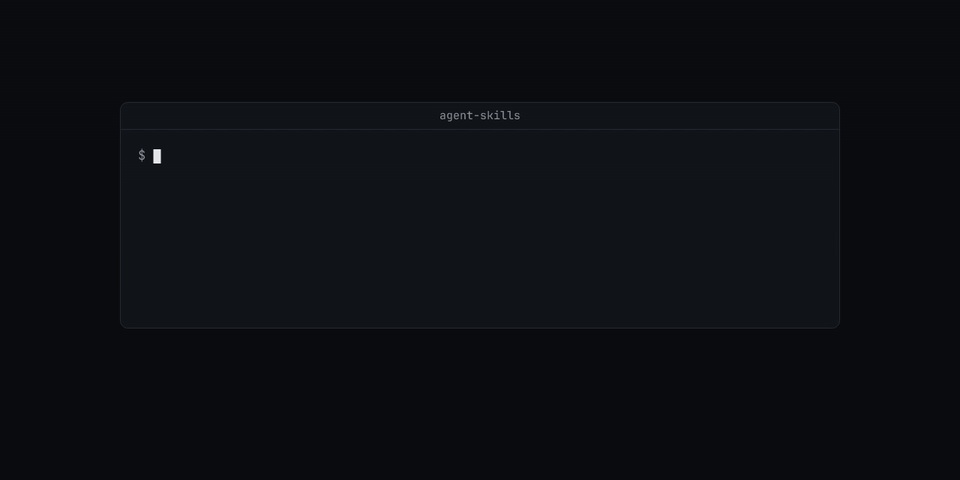

# agent-skills

Seven Claude Code skills for running Codex and Pi agents beside Claude, driving a browser, telling the time, and making product and launch films.



## Why

A skill is a folder with a `SKILL.md`. Claude Code reads the name and description at the start of a session and loads the full text when a task matches. These seven skills hold workflows that took many runs to get right: how to brief and steer a Codex lane, how to run a review loop that stops before it grows the diff, how to keep a browser session tied to one task, and how to make a film whose choices come from the product instead of the model's defaults. Each one also names the tools it needs, so the agent checks for them before it starts.

## Skills

| Skill | What it does | What it needs |
| --- | --- | --- |
| [`codex-lanes`](codex-lanes/SKILL.md) | Launch, steer and inspect long-running Codex lanes from a scoped brief. | The `codex-lane` CLI on `PATH`, the `codex` CLI signed in, `CODEX_HOME` if not `~/.codex`. |
| [`sol-loop`](sol-loop/SKILL.md) | Review Claude-written code with a Codex model in rounds, with a round budget (3 by default, 5 for auth, data loss or concurrency) and a scope fence. | `codex` CLI, `git`. `gh` when the change is a PR. |
| [`pi-delegate`](pi-delegate/SKILL.md) | Send work to approved API-key models through Pi, with sessions, worktrees, liveness checks and recovery. It runs only when you invoke it (`disable-model-invocation: true`). | `pi` CLI, Node.js, `git`. `PI_APPROVED_MODELS` and `PI_MODEL`. |
| [`pi-browser`](pi-browser/SKILL.md) | Drive browser flows with `agent-browser`, or Jev steps, on this machine or over SSH. Covers sessions, evidence screenshots, recordings and cleanup. | `agent-browser` and its browser runtime. `jev-browser` is optional. `BROWSER_HOST`, `BROWSER_LOG_DIR`. |
| [`product-film`](product-film/SKILL.md) | Make a product film in Remotion from the product's own components, design tokens and voice, cut to measured music beats. | A Remotion workspace in the product repo, `bun`, `npx`, `uv`. |
| [`no-slop-motion`](no-slop-motion/SKILL.md) | Make a narrated launch or brand film as HTML motion in HyperFrames and GSAP, through gates from customer pain to final render. Ships a starter project and QA scripts. | Node.js 20 or later, `ffmpeg`, `ffprobe`, Python 3 with `uv`. `CARTESIA_API_KEY` for generated voice. |
| [`now`](now/SKILL.md) | Print the date, time and part of day before the agent says "tonight" or "this morning". | Bash, GNU `date`. `LOCAL_TZ` (default `UTC`). |

## Install

Requirements: Claude Code, plus the tools in the table for each skill you use. Skills are plain files, so installing one is a copy.

1. Create the user skills directory:

   ```bash
   mkdir -p ~/.claude/skills
   ```

2. Copy every skill, or only the folders you want:

   ```bash
   cp -r $(dirname */SKILL.md) ~/.claude/skills/
   cp -r now sol-loop ~/.claude/skills/
   ```

   The skills refer to their own files by installed paths such as `~/.claude/skills/now/scripts/now.sh`, so keep each folder name.

3. Start a new Claude Code session. Claude Code reads skills at session start.

A skill under `.claude/skills/` inside a project applies to that project only.

## Quick start

Install all seven into an empty skills directory:

```console
$ cp -r $(dirname */SKILL.md) ~/.claude/skills/ && ls ~/.claude/skills
codex-lanes
no-slop-motion
now
pi-browser
pi-delegate
product-film
sol-loop
```

Run the `now` script, which Claude runs when the skill loads:

```console
$ LOCAL_TZ=Europe/Berlin bash now/scripts/now.sh
now: Tue 03 Nov 2026 20:02 CET (local, Europe/Berlin)
     Tue 03 Nov 2026 19:02 UTC
     Tue 03 Nov 2026 14:02 EST (US East / Toronto)
     part of day: evening
```

Check a model against the `pi-delegate` allowlist before you dispatch to it:

```console
$ node pi-delegate/model-policy.mjs --check openai-codex/gpt-6.1-sol
model openai-codex/gpt-6.1-sol is not approved for pi; use an exact ID from PI_APPROVED_MODELS or the defaults in model-policy.mjs.
$ echo $?
2
```

Run the `no-slop-motion` linter tests:

```console
$ bun test no-slop-motion/scripts/qa/lint-slop.test.ts
bun test v1.3.14 (0d9b296a)

 8 pass
 0 fail
Ran 8 tests across 1 file. [2.37s]
```

## How it works


Each `SKILL.md` starts with YAML frontmatter that holds `name` and `description`. Claude Code puts the descriptions in the agent's context, and the agent loads a skill's body when the task matches the description, or when you type `/<name>`. `pi-delegate` sets `disable-model-invocation: true`, so only `/pi-delegate` loads it.

The body is instructions, not code. The skills call tools that you install yourself:

- `codex-lanes` drives the `codex-lane` CLI, which keeps one steerable `codex app-server` per lane. It ships separately.
- `sol-loop` runs `codex exec -m <model>` as the reviewer, one reviewer per round, and keeps a ledger of findings with severity and outcome.
- `pi-delegate` runs `pi` directly, or through `pi-launch.sh` (one detached turn with its real pid recorded for liveness checks) and `delegate.mjs` (a bridge to the pi-subagents extension in a persistent Pi session). `model-policy.mjs` checks models against `PI_APPROVED_MODELS` and, with `--scope`, prints the `subagents.modelScope` block for `~/.pi/agent/settings.json`. `worktree-seed.sh` seeds a new git worktree from an installed sibling checkout. It links every `node_modules` and copies untracked local files, including `.env*`, `.npmrc`, `.pi/` and `.codex/`. `gate.sh` is a template for a monorepo's check script, and `run-lane.sh` resumes a long extraction job until its report is complete.
- `pi-browser` drives `agent-browser` sessions, locally or through `ssh "$BROWSER_HOST"`, and writes evidence to `BROWSER_LOG_DIR`.
- `product-film` copies `templates/kit/` and `scripts/` into the product's `videos/` workspace. `scripts/beats.py` finds beats in the music, `scripts/stills.ts` and `scripts/render.ts` render through Remotion, and `scripts/verify.py` checks the final files.
- `no-slop-motion` starts each film from `starter/`, a HyperFrames project pinned to `hyperframes@0.8.78`. Its scripts score and split voice takes, join music on downbeats, scan for pops, build contact sheets, mix audio and lint the composition for default-looking motion.

## Configuration

Skills read these environment variables. Set them in the shell that starts Claude Code.

| Variable | Skill | Default | What it does |
| --- | --- | --- | --- |
| `CODEX_HOME` | `codex-lanes`, `sol-loop` | `~/.codex` | Codex account and configuration directory. |
| `PI_APPROVED_MODELS` | `pi-delegate` | the list in `model-policy.mjs` | Comma-separated `provider/model` IDs Pi may use. |
| `PI_MODEL` | `pi-delegate` | `openrouter/z-ai/glm-5.3-flash` | Default Pi model. It must be in the allowlist. |
| `PI_GATE_INSTRUCTIONS` | `pi-delegate` | built-in gate text | Replaces the gate instructions the wrapper appends. Empty appends none. |
| `BROWSER_HOST` | `pi-browser` | unset | SSH alias of the machine that runs the browser. Unset runs locally. |
| `BROWSER_LOG_DIR` | `pi-browser` | `$HOME/browser-evidence` | Directory for screenshots and recordings. |
| `CARTESIA_API_KEY` | `no-slop-motion` | unset | Key for generated narration. Picture-only work does not need it. |
| `LOCAL_TZ` | `now` | `UTC` | IANA time zone for the local line. |

The default Pi allowlist is `openrouter/z-ai/glm-5.3-flash`, `opencode/deepseek-v4-pro`, `opencode/deepseek-v4-flash`, `opencode/kimi-k3` and `opencode/qwen3.8-max`. The Pi launchers set `DO_NOT_TRACK=1` and `PI_TELEMETRY=0`. The film skills tell the agent to set `DO_NOT_TRACK=1`, and `HYPERFRAMES_NO_TELEMETRY=1` for HyperFrames.

## Limits

- The skills are instructions for an agent. They do not install their tools. The film skills start with a check for the tools they need.
- `codex-lanes` needs the separate `codex-lane` CLI, which runs on Linux only.
- `now` needs GNU `date`. The BSD `date` on macOS does not accept `date -d @<seconds>`.
- `sol-loop` and `codex-lanes` mention T3 Code's delegation tools. Outside T3 Code they fall back to the `codex` and `codex-lane` CLIs.
- The film skills are long workflows. Each gate waits for the person who approves the film to sign off before the next one starts.
- Remotion, which `product-film` uses, has its own license. Check it before commercial use.
- Tested here: the copy install, `now.sh`, `model-policy.mjs --check` and `--scope`, and the `lint-slop` tests. The film render scripts, `pi-delegate`'s launchers and `pi-browser` flows were not run for this README.

## License

MIT. See [LICENSE](LICENSE). Some files carry their own licenses:

- `sol-loop/` is adapted from Theo Browne's tstack under the MIT license in `sol-loop/LICENSE`.
- `no-slop-motion/starter/assets/vendor/gsap.min.js` is GSAP 3.14.2 under the Standard "No Charge" GSAP License in `no-slop-motion/starter/assets/vendor/LICENSE`. It is not MIT. It forbids use in tools that let users build visual animations without code in competition with Webflow.
- The Inter and Archivo fonts in `no-slop-motion/starter/assets/fonts/` are under the SIL Open Font License 1.1.
